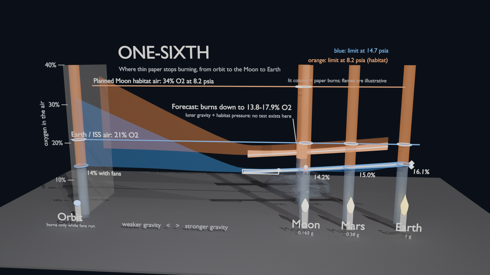

# One-Sixth: the first fire forecast for the Moon base

NASA Space Apps Challenge 2026, **Flame in Freefall** · forecast v2

No fire experiment has run on the Moon. NASA plans landers, habitats and rovers with oxygen-rich air (34% O₂ at 8.2 psia). One-Sixth gathers NASA's reduced-gravity fire data into one cited dataset and fits two models to it. Each model is checked against Earth results it never saw, and only models that pass get to forecast. A separate reviewer then tries to break every claim. The forecast is timestamped so it can be scored when lunar data arrives.

## Results in brief

- **Earth checks.** Model 2 on thin cellulose passes: it predicts 16.2% O₂ (15.4–17.2) against a measured 15.6% and 16.5%. Model 1 passes weakly. Model 2 on thin acrylic (PMMA) fails, so there is no PMMA forecast.
- **Already measured.** NASA aircraft tests bracket the lunar limit for thin cellulose between 14% and 15% O₂ at normal pressure, about 1 to 2.4 points below Earth. The models reproduce this; they do not predict it.
- **Forecast.** At lunar gravity and habitat pressure (8.2 psia), thin cellulose keeps burning down to **13.8–17.9% O₂**, most likely near 15.5%. No test exists at this combination. The planned habitat air is 34%.
- **Attack round.** The reviewer found no bug that changes a number, but it showed that v1 overclaimed. `FORECAST.md` §8 lists what was withdrawn or weakened.

## What's here

| Path | What it is |
|---|---|
| `web/index.html` | Gravity slider, Earth-check scoreboard, draft-speed chart and attack-round table. Self-contained; open it in any browser. |
| `FORECAST.md` | The registered forecast: scope, evidence, models, Earth checks, scorable claims, risks, changes from v1. |
| `data/flammability_evidence.csv` | 41 curated rows: gravity, pressure, O₂, flow, outcome, citation, and role (training, held out, dataset only). |
| `data/raw/` | NASA PSI test tables as served: BASS-II (129 tests), BASS (122), Saffire I, II, III. CC0. |
| `model/one_sixth_model.py` | Model 1: a two-sided curve in gravity. |
| `model/physics_model.py` | Model 2: radiative loss and reaction time against draft speed, with a physical pressure step. |
| `model/run_all.py` | Runs both models and writes `outputs/results_v2.json` and `outputs/curves_v2.json`. |
| `model/sensitivity.py` | Variants prompted by the review. |
| `outputs/review.json` | The reviewer's eight findings and what we did about each. |
| `outputs/v1/` | The v1 outputs, kept for the record. |
| `docs/index.html` | A copy of the page for GitHub Pages (Settings → Pages → branch `main`, folder `/docs`). |
| `blender/` | The result as a 3D Blender scene, built from the same numbers. See `blender/README.md`. |
| `AGENTS.md` | Briefing for AI agents working in this repo: safe numbers, wording to avoid, and the Blender task. |
| `SUBMISSION.md` | Text for the Space Apps form and the demo script. |
| `HASHES.txt` | SHA-256 of the registered files. |

## In 3D



Left to right is gravity, height is oxygen. The lit part of each column is where thin paper burns. The Moon-base column on the orange row carries the forecast, with the planned 34% habitat air marked far above it.

## Run it

```bash
pip install numpy
python3 model/run_all.py        # about 2.5 minutes, fixed seeds
python3 model/sensitivity.py    # about 2 minutes
python3 web/build.py
open web/index.html
```

## Honest limits

- One material class: thin cellulose tissue, flame spreading downward in still air.
- The reduced-gravity data come from aircraft parabolas of about 20 seconds, which may bias limits low.
- The pressure step is an extrapolation in both models.
- The two models share the same evidence, so their agreement is not independent confirmation.

## Use of AI

Claude (Anthropic) retrieved the NASA data and reports, extracted the evidence rows, wrote the model code, page and write-up, and ran the independent review in a separate context. The team chose the approach and is responsible for the claims.

## License

Code, curated data and text: CC0 1.0. NASA PSI tables: CC0 as released by NASA.
