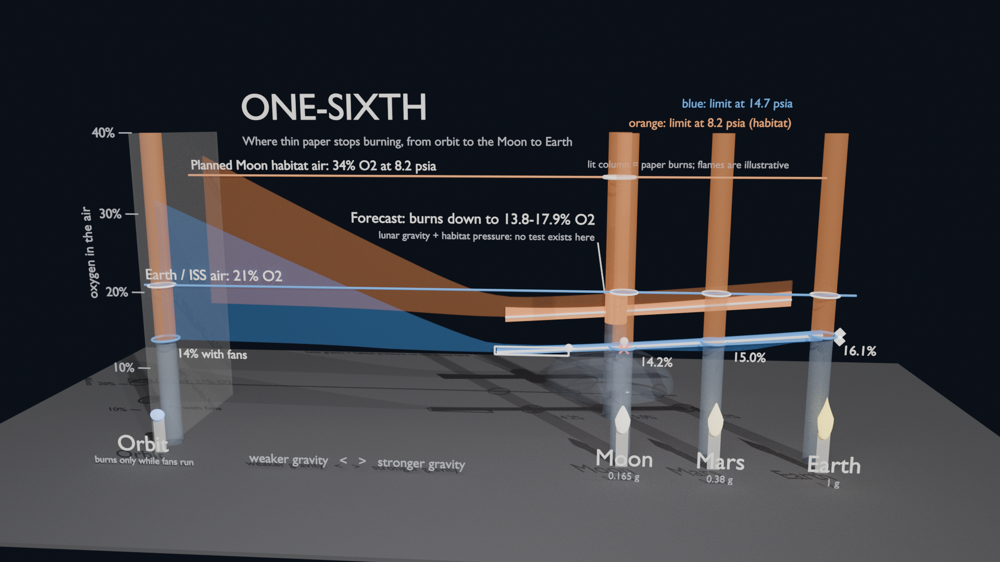

# One-Sixth in Blender

A 3D version of the result: where thin paper stops burning, from orbit to the Moon to Earth.



## Files

| File | What it is |
|---|---|
| `scene_data.json` | Every number the scene uses, generated from the registered model outputs |
| `make_scene_data.py` | Regenerates `scene_data.json` |
| `build_scene.py` | Builds the whole scene with Blender's Python API |
| `one_sixth.blend` | The saved scene |
| `renders/one_sixth_hero.png` | Current still |

## Run it

```bash
python3 blender/make_scene_data.py
blender --background --python blender/build_scene.py -- --render --save
# options: --engine EEVEE  --samples 128  --res 1920x1080  --frame 120
```

Or open `build_scene.py` in Blender's Text Editor and press Run Script.

## How to read the scene

- **Left to right:** gravity, from orbit to the Moon, Mars and Earth.
- **Height:** oxygen in the air.
- **Blue row:** normal pressure (14.7 psia). **Orange row:** habitat pressure (8.2 psia).
- **Ribbons:** the oxygen limit. Above a ribbon thin paper burns; below it the flame goes out.
- **Columns:** the lit part is where paper burns. Rings mark the air people breathe: 21% on Earth, 34% planned for the Moon habitat.
- **Moon-base column (orange row):** the forecast, 13.8–17.9% oxygen. The 34% ring sits far above it.
- **Small markers:** NASA measurements.
- **Flames:** illustrative only.

## Handing this to GPT-6 Astra

Astra reads `AGENTS.md` at the repo root, which holds the full brief, the numbers it may use and the wording it must avoid. Paste this to start it:

> Clone https://github.com/ayden-techdall/NASA-Space-OneSixth and read AGENTS.md first. Your task is section 5: improve the Blender scene in `blender/`. Run `blender/build_scene.py`, look at the render, and fix the weaknesses listed there in priority order. Take every number from `blender/scene_data.json`. Work on a branch called `blender-scene`, keep all changes inside `blender/`, render a 1920×1080 still to `blender/renders/one_sixth_hero.png`, write `blender/NOTES.md`, and open a pull request. Show me the render before you open it.
